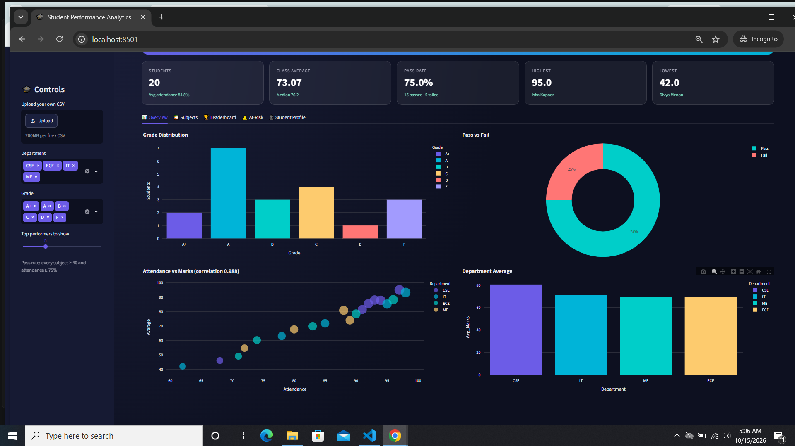
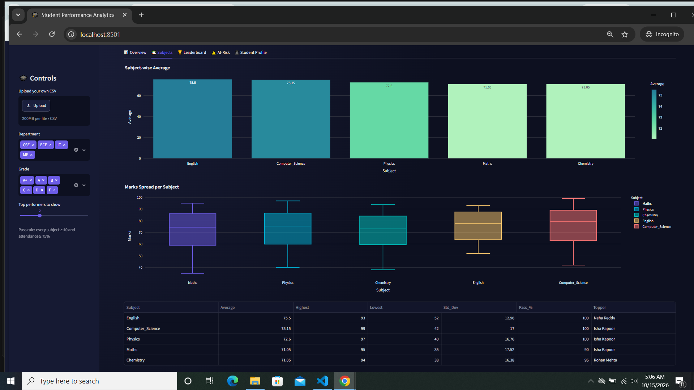
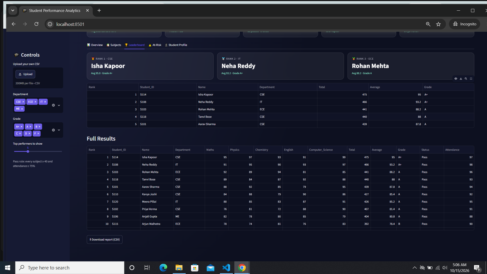
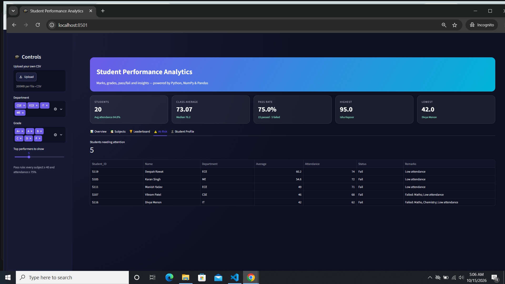
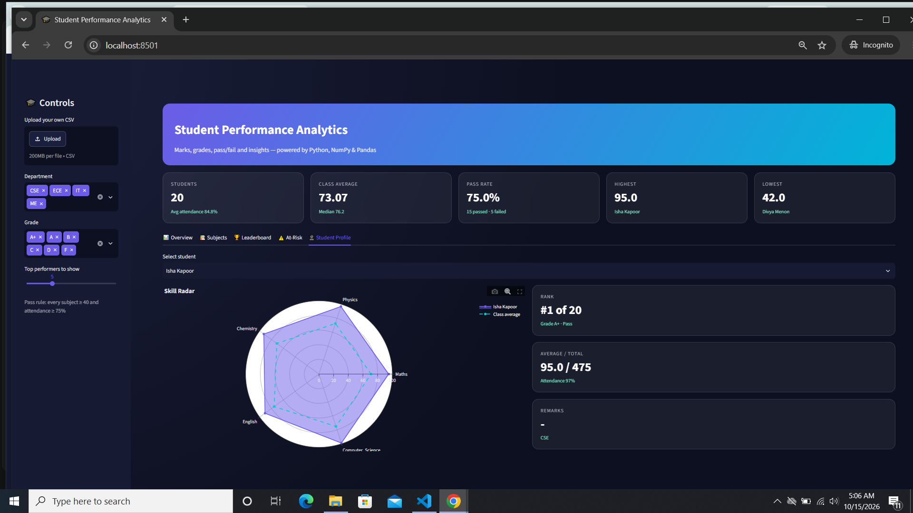
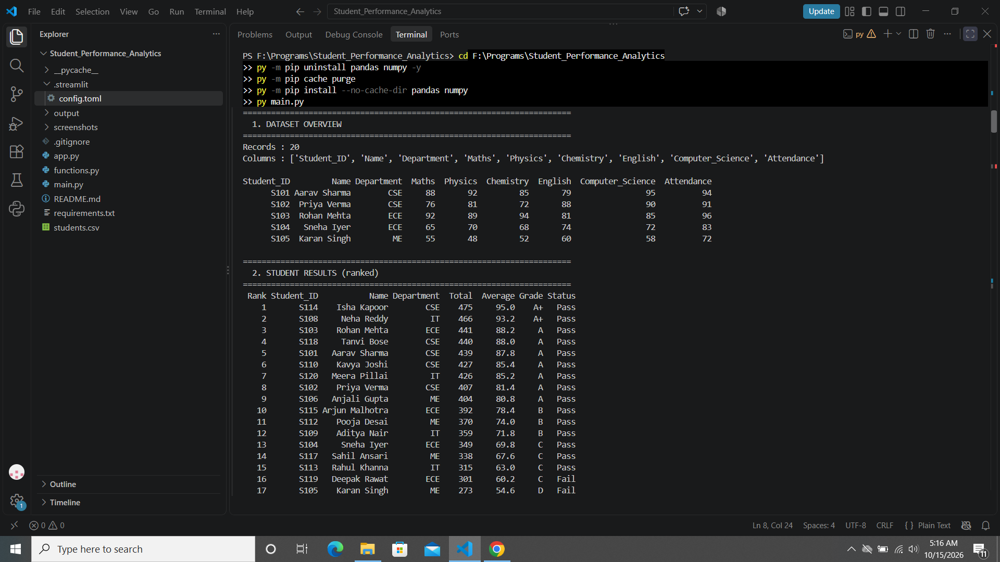
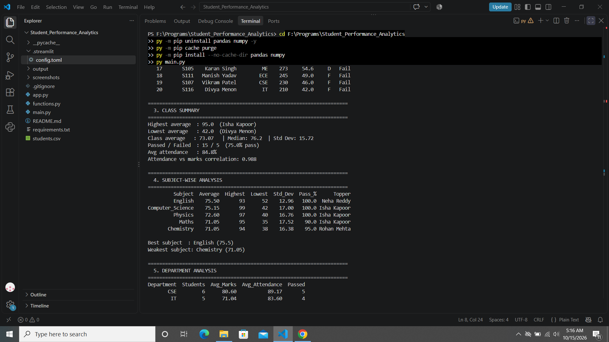

# 🎓 Student Performance Analytics System

A Python data-analysis project that reads student records, processes them with **NumPy** and **Pandas**, and produces totals, averages, grades, pass/fail results, subject-wise analysis, rankings and at-risk students, as both a **console report** and an **interactive dashboard**.



---

## 1. Project Title
**Student Performance Analytics System**

| | |
|---|---|
| **Student** | Diya Tayal |
| **Roll No / Batch** | 2502161630070 |
| **Course** | Python with AI, EWB Courses |
| **Submission Date** | 16 October 2026 |

## 2. Objective
Teachers and institutes usually have raw marks in a spreadsheet but no quick way to understand them. This project solves that by automatically answering practical questions:

- Which student has the highest average?
- Which subject performs best, and which is weakest?
- How many students passed, and who needs attention?
- What is the overall class average?
- Does attendance affect marks?

## 3. Technologies Used
| Tool | Purpose |
|---|---|
| **Python 3.12** | Core language: functions, loops, conditions |
| **NumPy** | Numerical calculations (sum, mean, median, std, correlation) |
| **Pandas** | Loading CSV, DataFrames, filtering, grouping, ranking |
| **Streamlit** | Interactive dashboard UI |
| **Plotly** | Charts (bar, pie, scatter, box, radar) |

## 4. Dataset Description
`students.csv` contains **20 student records** (sample data created for this project).

| Column | Description |
|---|---|
| `Student_ID` | Unique ID (S101 to S120) |
| `Name` | Student name |
| `Department` | CSE, ECE, IT or ME |
| `Maths`, `Physics`, `Chemistry`, `English`, `Computer_Science` | Marks out of 100 |
| `Attendance` | Attendance percentage |

## 5. Implementation

**Step 1: Load the data.** `load_data()` reads the CSV with Pandas, checks that all required columns exist, removes duplicate IDs and drops rows with invalid numbers.

**Step 2: Calculate totals and averages.** `calculate_totals()` converts the marks to a NumPy array and uses `sum(axis=1)` and `mean(axis=1)` for every student at once.

**Step 3: Assign grades.** `assign_grades()` loops over each average and calls `get_grade()`.

| Average | Grade |
|---|---|
| 90 and above | A+ |
| 80 to 89 | A |
| 70 to 79 | B |
| 60 to 69 | C |
| 50 to 59 | D |
| Below 50 | F |

**Step 4: Pass/fail.** `check_pass_fail()` loops over every student. A student **passes** only if:
- marks are **at least 40 in every subject**, and
- attendance is **at least 75%**.

The `Remarks` column explains the exact reason for a fail (failed subjects, low attendance).

**Step 5: Rank and analyse.** `add_rank()` ranks students by average. Then:
- `class_summary()` gives highest, lowest, average, median, std dev and pass percentage
- `subject_analysis()` gives subject-wise average, highest, lowest, pass % and topper
- `department_analysis()` uses Pandas `groupby`
- `top_performers()` and `at_risk_students()` filter the DataFrame
- `attendance_correlation()` uses `np.corrcoef`

**Step 6: Present.** `main.py` prints a formatted console report and saves `output/student_report.csv`. `app.py` shows the same results as a dashboard.

## 6. Key Features
- Total, average, grade, rank and pass/fail for every student
- Highest, lowest, average, median and standard deviation of performance
- Subject-wise analysis with a topper for each subject
- Department-wise comparison
- Top performers leaderboard with medals
- At-risk students list with the reason
- Attendance vs marks correlation
- Student profile with a radar chart compared to the class average
- Dashboard filters (department, grade), CSV upload and report download
- Dark, modern UI with KPI cards and interactive charts

## 7. Output / Screenshots

### Interactive dashboard
| Overview | Subjects |
|---|---|
|  |  |

| Leaderboard | At-Risk |
|---|---|
|  |  |

| Student Profile |
|---|
|  |

### Console report



## 8. Final Outcome
The project runs end to end and gives clear, accurate results from the dataset:

| Question | Answer |
|---|---|
| Highest average | **Isha Kapoor** (95.0, Grade A+) |
| Lowest average | Divya Menon (42.0) |
| Overall class average | **73.07** (median 76.2) |
| Students passed | **15 of 20** (75%) |
| Best subject | English (75.5) |
| Best department | CSE (80.6 average) |
| Students at risk | 5 (mostly due to low attendance) |
| Attendance vs marks correlation | 0.988 (very strong positive) |

The project achieves all required features: dataset, Pandas DataFrame, NumPy calculations, reusable functions, loops, grading rule, pass/fail condition, subject-wise analysis and top performers, along with a dashboard as an extra.

## 9. Challenges & Learning
- **Python was not recognised in PowerShell.** The `python` command gave a Microsoft Store message. I learned that Windows has an "App execution alias" shortcut and that the **`py` launcher** works even when PATH is not set. I used `py -m pip` and `py main.py`.
- **Python Install Manager failed.** It needed a newer Windows 10 build than my laptop has. I solved it by downloading the normal Python 3.12 `.exe` installer instead.
- **Corrupt pandas installation.** `main.py` crashed with a "null bytes" error that came from inside pandas, not from my code. I read the traceback carefully, then uninstalled, cleared the pip cache and reinstalled with `--no-cache-dir`.
- **Designing the pass rule.** I had to decide how to combine subject marks and attendance, and I added a `Remarks` column so every fail is explained.
- **Dashboard readability.** The default light theme made text faint on my dark design. I fixed it with a `.streamlit/config.toml` theme file.
- **What I learned:** vectorised NumPy operations (`axis=1`), Pandas `groupby`, `nlargest` and ranking, writing reusable functions, reading error tracebacks, and using Git/GitHub to submit a project.

## 10. GitHub Repository
🔗 https://github.com/diyatayal27/Student_Performance_Analytics.git

---

## How to Run

**Requirements:** Python 3.10 or newer.

```bash
# 1. Install the libraries
pip install -r requirements.txt

# 2. Run the console report
python main.py

# 3. Run the interactive dashboard
streamlit run app.py
```

**On Windows, if `python` or `pip` is not recognised, use the `py` launcher:**
```bash
py -m pip install -r requirements.txt
py main.py
py -m streamlit run app.py
```

The dashboard opens at `http://localhost:8501`. To use your own data, upload a CSV with the same columns as `students.csv`.

## Project Structure
```
student-performance-analytics/
├── main.py              # Console report (runs the analysis)
├── functions.py         # Reusable calculation and processing functions
├── app.py               # Streamlit dashboard
├── students.csv         # Dataset (20 records)
├── requirements.txt     # Dependencies
├── README.md            # Project documentation
├── .gitignore
├── .streamlit/
│   └── config.toml      # Dashboard theme
└── screenshots/         # Output screenshots
```

## Future Improvements
- Add more students and semesters to track progress over time
- Export a PDF report card for each student
- Deploy the dashboard online with Streamlit Community Cloud


*Made by Diya Tayal for the EWB Courses Python with AI project assignment.*